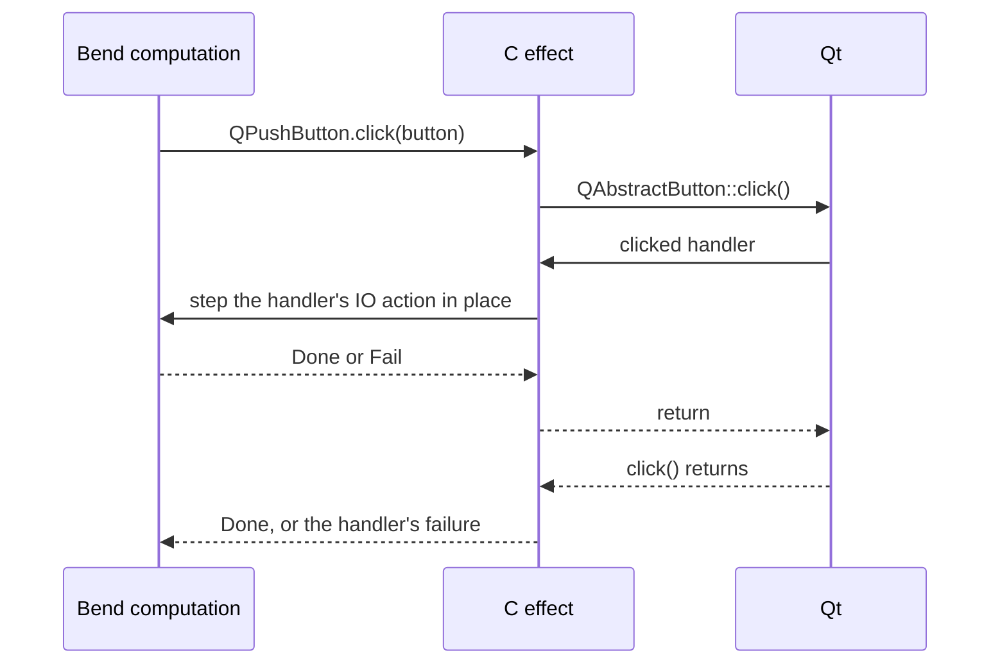

# Embedding Qt in a Bend program

The active package is `packages/qt612`. It is generated from Qt 6.12.0 headers
with the unmodified Shiboken 6.12.0 ApiExtractor, and it requires exactly
Qt 6.12.0, Bend 2.0.40 and a native Linux x86-64 CPU build. See
[generator setup and extension](../generator/README.md) and the
[consumer API and limitations](../packages/qt612/README.md).

## Distribution through BendHub

The package must work through BendHub and the standard Bend workflow. A
consumer imports it from the Hub and builds with `bend main.bend -o app`. There
is no SDK, separate build tool or binding-specific companion install. Having Qt
installed is acceptable; the consumer needs Qt's runtime libraries, not its
development kit, a C++ compiler or the generator.

In Bend 2.0.40, `pkg_files` collects local Bend modules, their imported foreign
source files, adjacent LICENSE files and the entry directory's README.md.
Foreign imports accept `.c` and `.js`; C source is spliced into the generated
program. The publisher does not collect a C++/CMake project or follow C
includes to package headers. The native build compiles C11 with fixed
libraries and limited platform detection, without package build hooks or
dependency metadata.
[Publisher](https://github.com/bendlang/bend/blob/v2.0.40/bend2/main.ts#L828),
[native build](https://github.com/bendlang/bend/blob/v2.0.40/bend2/main.ts#L491),
[foreign imports](https://github.com/bendlang/bend/blob/v2.0.40/bend2/bend.ts#L2548).

The package therefore consists of `qt.bend` and C effects. Loading
native libraries at run time is an established pattern for Hub packages. On
9 November 2026 a fresh consumer imported
`bend-kit-sqlite@0.1.0.1/sqlite.bend` (snapshot
`0x1dd647736fb09289bc1eed9825ef1113`). Stock Bend 2.0.40 with Clang 19 fetched
it into an empty cache, compiled it with the ordinary `-o` option, opened
`:memory:`, prepared `SELECT ? + ?`, bound 19 and 23 and printed 42. Its C
effect declares function pointers itself and loads the installed
`libsqlite3.so.0` with dlopen and dlsym, so it needs no SQLite header or linker
flag and does not bundle SQLite. The executable's ldd output lists only libc
and libm. bend-kit-wire (OpenSSL), bend-kit-zlib (libz, libzstd, libbrotlidec)
and bend-smtp (OpenSSL, loaded at run time) follow the same approach.
[SQLite package](https://github.com/paymog/bend-kit/tree/main/sqlite),
[C effect](https://github.com/paymog/bend-kit/blob/main/sqlite/effs/sqlite.c),
[native dependencies](https://github.com/paymog/bend-kit#native-libraries),
[SMTP implementation](https://github.com/kbrianps/bend-smtp/blob/main/net.c).

## The packaged C effects

`qt.c` holds the Bend effect adapter, the request layout shared with the C++
side (`generator/templates/abi.h`) and the base group's compiled C++ wrappers
as an embedded payload. Each other native group has its own `qt-<Group>.c`
with its payload, and the bundled runtime's files are spread over
`qt-runtime-NNNN.c` pieces. Bend compiles only the files that the program's
reachable definitions import. The C refuses to compile for anything other than
a native Linux x86-64 CPU build.

The maintainer generator compiles each group's C++ wrappers against Qt 6.12.0
and links them into a shared library. Packaging strips it and rejects text
relocations, library search paths, unplanned `NEEDED` entries, exports other
than `bqt_abi_call`, `bqt_abi_start` and `bqt_abi_stop`, and relocation
families it does not recognise. The library is then compressed and embedded
as base64 text.

When Qt is first needed, the effect:

1. extracts the bundled runtime into its cache directory, unless
   `BEND_QT_RUNTIME` names a replacement, and points Qt's plugin and QML
   search paths into it;
2. dlopens the runtime's Qt libraries and rejects versions other than 6.12.0
   reported by `qVersion()`;
3. loads the base group's payload and resolves its three entry points.

Another group's payload loads when the program first uses that group, or on
`Modules.<Group>.load()`. A package generated without a bundled runtime instead
dlopens the installed `libQt6Widgets.so.6`, or the path in `BEND_QT_LIBRARY`.

Each payload is cached as a file. Its directory under `$XDG_CACHE_HOME/bend-qt`
or `~/.cache/bend-qt` is named by the payload's content, next to the runtime
directories. The first start inflates the payload with `uncompress` from the
already required `libz.so.1`, loaded with dlopen. It writes the library under a
temporary name, renames it into place and records a stamp of its inode, size,
mode and modification time. A later start that reproduces the stamp dlopens the
file directly, without decoding it, and shares its pages with other running
programs. A file that no longer matches its stamp is decoded and written again.
As with the runtime, running programs hold the directory, and directories
unused for a week are removed.

The library stays loaded for the life of the process. The consumer executable
has no link-time Qt or C++ dependency.

## Startup

The first Qt effect starts Qt. It loads the libraries and payload as above
and starts the runtime without an application object. As in C++, the program
then constructs exactly one with `QCoreApplication.new`,
`QGuiApplication.new` or `QApplication.new`, from Bend's command-line
arguments; Qt removes the options it recognises from its own copy. A second
construction fails with EEXIST. Until a GUI application exists, constructors
and static functions of QtGui and QtWidgets classes, and of classes deriving
from them, fail with ENXIO, rather than letting Qt abort the process; static
setters of global defaults and the web modules' `initialize` precede it, as
Qt requires. Startup is attempted once. If it fails, that effect and every
later Qt effect fail with ELIBACC (79) and the loader's message, which
`IO.try` can report.

## One thread

Qt and Bend share the process main thread.

A Bend effect calls Qt directly. The generated wrapper checks its handles,
calls the Qt function and returns the result before the effect returns. Each
such call is one Qt operation started by Bend.

Qt processes events only inside a Qt event loop: `QCoreApplication.exec`,
`QEventLoop.exec`, `QDialog.exec`, `QCoreApplication.processEvents` and Qt's
other blocking operations. Timers, repaints, input and signals queued from
other threads are handled there and nowhere else. A Bend computation that runs
for a long time without entering such a loop delays Qt's events until it does.

While a Qt event loop waits, Bend's other computations keep running. The
payload's `BendHost` object watches the main thread's event dispatcher:

- Before the dispatcher blocks, it flushes Bend's buffered standard output. If
  a Bend computation is ready, it schedules a run instead of letting Qt sleep.
- Otherwise it asks Bend what its waiting computations wait on: Bend's wake
  descriptor, the descriptors of parked effects and the nearest deadline. It
  arms one `QSocketNotifier` per descriptor and a precise single-shot `QTimer`
  for the deadline. With more than 256 descriptors it watches the first 256
  and looks again within 10 ms.
- When a notifier or the timer fires, it runs every ready Bend computation up
  to its next wait. Runs happen from ordinary event dispatch, never from inside
  the dispatcher's own bookkeeping.
- When the dispatcher wakes, it disarms the watches. A loop that never blocks
  still lets Bend check its sources every 10 ms.

Outside a Qt event loop `BendHost` does nothing; Bend's own IO loop is in
charge. A computation run by `BendHost` may call Qt, including starting a
nested event loop. Package operations that wait, such as `Future_X.await` and
QML incubation waits, run a Qt event loop in the same way until their
condition holds.

## Handlers

Qt calls Bend through handlers: a connected signal, a virtual method of an
object made by `X.newOverride`, a std::function Qt stores (`X.methodWithHandler`),
a QML bridge call, the message handler, a converter-state cleanup or an RHI
cleanup or readback.

A handler is a closed top-level function (or closed lambda) and a `Data` state
value, passed as template arguments `~S` and `~f` with the state as the last
value argument. A closed function is a static closure that can be applied any
number of times. The C effect keeps the function and state in a handler table
and gives Qt a generation-checked token. Every call receives its own unshared
copy of the state. Qt gives the token back when the connection closes, the
override object is destroyed or the stored function object is deleted; the
state is then released. Handler parameters must be plain (no `+`), because
Bend function types include parameter quantities.

When Qt calls a handler, the payload converts the C++ arguments, and the
effect builds the handler's IO action and steps it in place, as Bend's own loop
steps a computation. No Bend evaluation is in progress while an effect or Qt
runs, so this is the only evaluation on the stack. The handler's effects run
inline as well. A handler may call Qt, and Qt may then run other handlers;
invocations nest. `IO.spawn` inside a handler starts a computation that runs
after the handler. Qt has the handler's answer before the C++ call returns, as
with a C++ slot or override.

Arguments are valid during the call. Value arguments are copies owned by the
call, and object arguments are borrowed handles that stay checked until the
handler has answered. A handler copies a value to keep it.

Results and failures:

- A virtual method handler returns the method's result; a signal with mutable
  reference arguments returns their new values. The answer is copied or
  adopted before the call's scope ends.
- A handler that fails makes the Bend-started Qt operation during which Qt ran
  it fail with the same code and message. The first failure is kept; later
  ones in the same operation are dropped. For example, `QPushButton.click`
  fails with 44 when its clicked handler fails with 44. A Qt event loop keeps
  running until it is exited and then reports the failure; the package's own
  waits end at once.
- A virtual method handler that fails with ENOSYS (38, `Qt.Virtual.base`) runs
  the C++ base implementation. A virtual without a handler does the same; a
  pure virtual without one fails the current operation with ENOSYS.
- A handler that finishes without an answer Qt needs fails with ENODATA.
- A handler that must give Qt a value cannot wait (sleep, channel, socket).
  When it parks, the Qt call fails with EWOULDBLOCK (11). A handler that returns
  nothing may wait; its remainder continues as an ordinary Bend computation.

## Other threads

Bend code runs only on the main thread, and Bend works with objects that live
there. A generated wrapper rejects a QObject owned by another thread with
EXDEV (18), except for documented thread-safe operations. `QObject.moveToThread`
and `QObject.deleteLater` are ordinary Qt methods.

- **Signals.** Each connection has a context object on the main thread. Qt runs
  the handler directly when the signal is emitted on the main thread and
  through its queued delivery when it is emitted on another thread. Queued
  emissions are delivered when the main thread runs a Qt event loop.
- **Virtual methods.** A virtual method Qt calls on another thread is sent to
  the main thread with a blocking queued call, and the calling thread waits for
  the handler. The main thread must be inside a Qt event loop to take the call.
  A main thread that is itself waiting for the calling thread never does. If
  the main thread cannot take the call or the object is gone, the C++ base
  implementation runs, or a default value for a pure virtual.
- **Runtime-defined members.** Property reads, writes, metatype queries and
  named methods called by an object's native owner thread use that same
  blocking dispatch. Only the main thread accesses their registry and Bend
  storage. The caller keeps its arguments alive until the answer returns.
- **Rendering.** Scene-graph and render callbacks run Bend handlers only under
  Qt Quick's main-thread render loop, which `Render.useGuiThread` selects before
  any Quick window exists. On a render thread the C++ base implementation runs.
- **Messages.** Messages logged on other threads, or while the message handler
  itself runs, go to the previously installed handler.
- **Releases.** Qt may drop a handler on another thread. The token is then
  queued and given back to Bend at the next Qt operation on the main thread.

## Exit and stopping

A Qt event loop ends the usual way, for example through
`QCoreApplication.exit__Int32(code)`, which makes `QCoreApplication.exec`
return `code`. A typical program connects a handler that calls it and then
runs `exec`.

The effect supplies the C `main` and renames Bend's generated entry point, so
it can tear Qt down after Bend's main returns and before the C library runs its
exit handlers. Teardown runs pending deferred deletions, closes every
connection, releases the objects Bend still owns, destroys the application and
collects again. No handler runs after Bend's main has returned. The process
then exits with Bend's status.

`IO.exit`, anywhere including inside a handler, ends the process the way a C++
program calling `exit()` does: Qt is not torn down. A fatal Bend runtime error
ends the process with status 1, also without teardown.
[Bend fatal errors](https://github.com/bendlang/bend/blob/v2.0.40/bend2/comp.ts#L3576).

Setting `BEND_QT_CHECK_SHUTDOWN` makes teardown print `QT612_SHUTDOWN_OK
owned=0`, or report leaked owned entries and exit with status 126. This is a
maintainer diagnostic for deliberate external cycles; teardown never forces
deletion in an unsafe order to hide them.

## Bend runtime interface

The C effect uses Bend 2.0.40's native effect interface, which is version
specific. It relies on these facts, checked against the generated runtime and
by the integration tests:

- Effects run on the main thread from `io_step`, and no evaluation is active
  while one runs, so an effect may step an IO action inline.
- A closed lambda or top-level function passed to an effect is a static
  closure that can be applied repeatedly. `Clo_apply` supplies the last
  argument; the closure environment holds the others.
- Reusing Data state held by native code requires `term_keep` and an unshared
  top node rebuilt with `ctr_take`; `term_drop` releases it.
- A waiting effect parks on `io_park` with a descriptor, event mask or
  deadline; `io_wake_fd`, `io_runs`, `io_wait` and `io_step` let `BendHost`
  watch and continue computations.
- Bend 2.0.40 emits its generated `main` immediately after imported C, which
  the `main` renaming depends on. This order is undocumented.
  [Bend emission order](https://github.com/bendlang/bend/blob/v2.0.40/bend2/comp.ts#L5880).

The generated runtime exposes no version macro, so the verification harness
checks the Bend pin. Recheck these facts before upgrading Bend.

## Generation from Shiboken

PySide6 uses Shiboken's Clang-based ApiExtractor to read C++ declarations and
an XML type system to describe binding choices: ownership rules, conversions,
exclusions and injected code where C++ signatures are insufficient.
[Type system](https://doc.qt.io/qtforpython-6/shiboken6_generator/typesystem.html),
[QtWidgets policy](https://github.com/pyside/pyside-setup/blob/v6.12.0/sources/pyside6/PySide6/QtWidgets/typesystem_widgets_common.xml).

Shiboken's own output is C++ for Python extension modules and has no Bend
backend. The generator reuses the unmodified extractor through a custom driver
and discovers classes from the pinned PySide type systems. Applicable ownership
policy informs the Bend adapters; Python-specific conversions and injected code
are not copied.
[Generator implementation](https://github.com/pyside/pyside-setup/blob/v6.12.0/sources/shiboken6_generator/generator/main.cpp),
[ApiExtractor](https://github.com/pyside/pyside-setup/blob/v6.12.0/sources/shiboken6_generator/ApiExtractor/apiextractor.h).

Runtime QMetaObject reflection covers properties, signals and invokable
methods, but it cannot enumerate or call ordinary C++ methods, and inline
methods and template instantiations may have no exported symbol. The package
therefore uses compiled C++ wrappers, as PySide does; the maintainer's C++
compiler handles value layouts, calling conventions, templates and cleanup.
[Shiboken considerations](https://doc.qt.io/qtforpython-6/shiboken6_generator/considerations.html).
